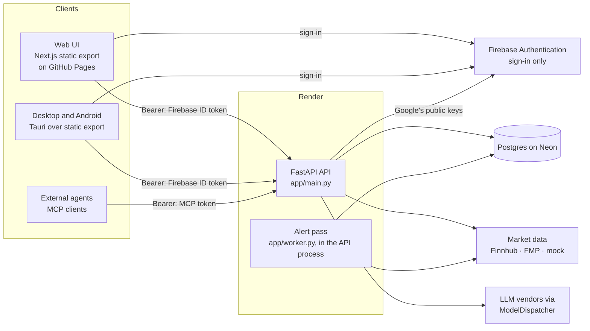

# MoatMine — High-Level Design

This document describes the system **as built**. Each
claim names the file it comes from. Where the code has no answer, this doc says so instead of
filling the gap. For which file holds what, see [`STRUCTURE.md`](STRUCTURE.md). For contracts
and the logic that isn't obvious, see [`LLD.md`](LLD.md).

## Requirements

### Functional
- **Safety score per stock.** A 0–100 score, with A–F grades by area and red flags, built from
  fundamentals, price risk, crisis behaviour, size, valuation and moat.
  - Calculation: `app/safety/score.py`.
  - Data gathering: `app/safety/service.py` `stock_safety`.
- **User risk rules.** A questionnaire sets the level, the rules can be edited, and the rules
  are stored per user (`app/safety/profile.py`, `RiskProfile` in `app/models.py`).
- **Every buy is checked against those rules.** The verdict is pass, warn or block
  (`app/safety/check.py` `check_buy`).
  - A warn needs a written reason and a cooling-off wait before the buy plan can execute
    (`app/routers/safety.py` `create_plan` / `execute_plan`).
- **Portfolio risk and stress tests.** Volatility, beta, VaR, drawdown, concentration and
  correlation, plus past crises and hypothetical 10/20/35% market falls replayed on today's
  holdings (`app/safety/risk.py`).
- **Real and paper books.** Paper (practice) accounts are a separate book. Totals, risk, stress,
  alerts and position sizing never mix the two (`app/portfolio.py`, `BookMode`).
  - Paper buys are priced at the live quote and paid from the paper account's cash
    (`pay_for_paper_buy`). Removing a paper position sells it at the quote. Paper positions can't
    be resized by editing, and an account can't move between books (`routers/portfolio.py`).
- **Targets and alerts.**
  - PAPI targets (Profit, Amount, Period, Intent) with MAMI min/max bounds (`app/targets.py`).
  - Watchlist price alerts.
  - A background worker turns breaches into deduplicated alerts (`app/worker.py`).
- **Research.** Fair value from several models (`app/valuation.py`), crisis history
  (`app/crises.py`), company data, earnings, analysts, dividends and news (`app/routers/stocks.py`).
- **AI agent.**
  - Chat with tool use over the user's own data, routed through ModelDispatcher
    (`app/ai/dispatcher.py`, `app/ai/tools.py`).
  - The same tools are served to external agents over MCP at `/mcp` (`app/mcp_server.py`).

### Non-functional (what the code enforces)
- **Runs without keys.** The mock market provider serves deterministic sample data
  (`app/market/mock.py`), and the UI labels it as sample data.
- **Honest data provenance.** Results built from fallback candles are labelled `mock-fallback`
  for each request (`app/market/sources.py`).
- **Fail closed on auth.** The API refuses to start with `AUTH_MODE=dev` on Postgres, or in firebase
  mode without a valid `FIREBASE_PROJECT_ID` (`app/config.py` `_auth_is_safe`).
- **Secrets stay out of logs.** Finnhub's key is sent as a header, and `token=`/`apikey=` values
  are redacted in every log line (`app/log_config.py`).
- **Per-user AI limits:** requests per minute, tokens per minute and tokens per day
  (`ai_*` settings, enforced by ModelDispatcher's quota store).
- **Not set anywhere in the repo:** latency or availability targets (SLOs), and capacity numbers.

## Static view



| Component | Owns | Code |
|---|---|---|
| Web UI | All screens; one API client; Firebase sign-in gate (email/password, Google in browsers) | `web/src/app/*`, `web/src/lib/api.ts`, `web/src/components/AuthShell.tsx` |
| Desktop and Android | Native window over the static export; no logic. Built and published by `.github/workflows/release.yml` and `android.yml` | `desktop/src-tauri/src/lib.rs`, `tauri.conf.json` |
| API: routers | HTTP surface, auth dependency, request validation | `app/routers/*.py`, `app/auth.py`, `app/schemas.py` |
| API: domain services | Gathering data for the maths; applying the user's rules | `app/safety/service.py`, `app/portfolio.py`, `app/research.py`, `app/targets.py` |
| Pure maths | Safety score, buy check, risk/stress, valuation, crises, moat | `app/safety/{score,check,risk,moat,profile}.py`, `app/valuation.py`, `app/crises.py`, `app/analytics.py` |
| Market data | Provider protocol, mock/Finnhub/FMP, routing and fallback, provenance | `app/market/*` |
| AI | Tool catalogue, ModelDispatcher wiring, encrypted per-user settings | `app/ai/*` |
| MCP server | Read-only tools for external agents, behind an MCP-token gate | `app/mcp_server.py` |
| Alert pass | Periodic alert evaluation, started hourly by a scheduled GitHub workflow | `app/worker.py`, `app/routers/internal.py`, `.github/workflows/alerts.yml` |
| Persistence | ORM models, sessions, Alembic migrations | `app/models.py`, `app/db.py`, `backend/migrations/` |

## Dynamic view

### Primary flow: checking a buy, then executing it through a plan

```mermaid
sequenceDiagram
  participant U as Web/Desktop
  participant R as routers/safety.py
  participant S as safety/service.py
  participant P as portfolio.py
  participant M as market provider
  participant C as safety/check.py
  U->>R: POST /plans {account_id, symbol, quantity, note}
  R->>M: quote(symbol)
  R->>S: check_for(user, symbol, amount, book of the account)
  S->>M: stock_safety(symbol): quote, candles, fundamentals, crises… (cached 10 min)
  S->>P: book_for(user, mode): snapshot of that book only
  S->>C: check_buy(rules, candidate, book)
  C-->>R: verdict pass | warn | block
  R-->>U: plan: ready | cooling_off (warn) | blocked; warn without a 20+ char reason → 422
  U->>R: POST /plans/{id}/execute (once ready)
  R->>S: check_for again (prices may have moved)
  R->>P: pay_for_paper_buy (paper accounts only; 409 if cash is short)
  R-->>U: holding created; the reason saved as a thesis note
```

### Other flows
- **Alert pass** (`app/worker.py` `run_once`), every `WORKER_INTERVAL_SECONDS`. In production a
  scheduled GitHub workflow (`.github/workflows/alerts.yml`, hourly) calls
  `POST /internal/alerts/run` (`app/routers/internal.py`, bearer `ALERTS_RUN_TOKEN`), which starts
  the pass in the API process and returns 202; Render's free plan has no background workers.
  `python -m app.worker` runs the same pass in a loop where workers exist.
  1. For each user, check real-book concentration and the loss limit (the holdings' fall from
     their 1-year high; daily bars cached for a day; skipped on sample data or when the history
     can't be fetched) against the risk rules, evaluate PAPI targets, and check watchlist price
     levels.
  2. Write alerts deduplicated on `(user, dedupe_key, unread)`; the unique partial index
     `uq_alerts_unread_dedupe` enforces it even if two passes overlap.
  3. Commit **per user**: one failing user doesn't drop anyone else's alerts.
  4. Record the pass in `worker_heartbeats` (finish time, duration, alerts, failed users), read by
     `GET /health/worker`. SIGTERM/SIGINT end the run after the current user.
- **Agent chat** (`app/routers/ai.py` → `app/ai/dispatcher.py` `chat`):
  1. Build a system prompt that includes the user's risk rules.
  2. ModelDispatcher picks a vendor from the user's keys and the server keys, and enforces quotas.
  3. Tool calls run through `app/ai/tools.py` `run_tool` against the same services the HTTP API
     uses.
- **MCP** (`app/mcp_server.py`):
  1. `_BearerGate` rejects requests without a valid hashed MCP token.
  2. Each tool resolves the user from the token and calls the same `run_tool`.

## Data storage
- **Primary store: Postgres on Neon** (free tier; `DATABASE_URL` in `render.yaml`'s shared env
  group). Render runs only the API, on its free plan. SQLite locally and in tests.
  - Neon's *direct* connection string, not its "-pooler" one: the migration lock below is a
    session-level advisory lock, which a transaction-mode pooler doesn't hold.
  - Neon suspends an idle database; `pool_pre_ping` (`app/db.py`) replaces connections it closed.
  - All user data is in one schema (`app/models.py`): accounts, holdings, watchlist, stock
    notes, targets, alerts, AI settings (encrypted), MCP tokens (hashed), risk profiles and buy
    plans.
  - The schema is owned by Alembic (`backend/migrations/`). `render.yaml` runs
    `alembic upgrade head` in the API's start command (free instances have no pre-deploy step). A Postgres advisory lock in
    `migrations/env.py` makes concurrent runs safe.
- **Cache: in-process only**, so each instance has its own:
  - `app/cache.py` `ttl_cache` holds safety reports (10 min) and sector lookups (1 h). At 2,000
    entries it drops expired entries first, then the oldest, and prunes idle per-key locks.
  - `app/research.py` stores AI news summaries (1 h) in the same store via `cache.get`/`cache.put`.
  - ModelDispatcher's quota store is `InMemoryQuotaStore` (`app/ai/dispatcher.py`).
  - Running more than one API instance would split caches and quotas. Nothing coordinates them.
- **Blob storage:** none.
- **Backup/DR:** Neon's own restore window for your plan, plus `pg_dump` backups you take
  yourself (`docs/RUNBOOK.md` "Database backup and restore").
- **Encryption at rest (application level):**
  - User AI keys are Fernet-encrypted with `FERNET_KEY` (`app/crypto.py`). Losing that key
    makes them unreadable, and no rotation is implemented.
  - MCP tokens are stored as SHA-256 hashes.

## Scaling
- **The API runs as one instance on purpose** (`numInstances: 1` in `render.yaml`). Three pieces of
  state live in process memory:
  - the TTL cache (`app/cache.py`), including AI news summaries;
  - ModelDispatcher's per-user AI quota store (`app/ai/dispatcher.py` `_QUOTA_STORE`) and the
    server-wide daily AI budget (`SERVER_BUDGET`);
  - the per-user request rate limits (`app/ratelimit.py`).

  With a second instance the quotas and rate limits would apply per instance (doubling them),
  and the caches would split. Move them to a shared store such as Redis before scaling out.
- **Database pool:** each process has its own pool, `DB_POOL_SIZE` + `DB_MAX_OVERFLOW` (5 + 5 by
  default). Requests wait up to `DB_POOL_TIMEOUT_SECONDS` for a connection. The API and worker
  together stay well under the connection limit of the `basic-256mb` Postgres.

## Config management
- **Precedence:** process environment over a local `backend/.env` over defaults in
  `app/config.py` `Settings` (pydantic-settings). There is no secrets-manager integration.
  - Render injects secrets as environment variables (`sync: false` keys in `render.yaml`).
- **Fail fast.** Every entry point builds `Settings` before it serves traffic: `app/db.py`
  creates the engine at import time. An invalid or unsafe value raises `ConfigError`, which
  carries only the reasons, never the values.
  - Validated: `auth_mode` and `log_format` must be one of their `Literal` values, dev auth is
    refused on Postgres, firebase mode must have a valid project id, and every `FERNET_KEY` must
    be a valid key (firebase mode requires one).
- **Web config is baked in at build time:** `NEXT_PUBLIC_API_URL` and the
  `NEXT_PUBLIC_FIREBASE_*` web-app settings. Users can override the API URL in Settings (localStorage).

## Data validation / I/O
- **Edge validation:**
  - Pydantic models validate request bodies (`app/schemas.py`, plus inline models in
    `routers/safety.py` and `routers/ai.py`).
  - Query parameters carry FastAPI bounds, for example the valuation assumptions in
    `routers/stocks.py`.
  - Symbols are upper-cased at the edge.
  - Every record lookup checks ownership (`_own` helpers).
- **Responses are JSON.** Accounts, holdings' notes, targets, alerts, watch items, quotes, candles,
  ratios, the safety check, buy plans, the chat reply and the model picker declare a
  `response_model` (`app/schemas.py`). `python -m app.openapi_spec` writes the OpenAPI schema to
  `web/openapi.json`; `npm run gen:api` turns it into `web/src/lib/api-schema.ts`, which
  `web/src/lib/api.ts` uses for those routes. CI regenerates both and fails on drift. The deeper
  reports (stock safety, valuation, crises, portfolio risk, stress, research) are still plain
  `JSONDict`s mirrored by hand in `api.ts`.
- **Provider responses are mapped defensively** (`.get` with defaults). A failed FMP call falls
  back to the primary provider. A failed quote marks the holding `stale` and prices it at cost.
- **Upstream retries:** Finnhub and FMP GETs retry 429/5xx and connection errors up to 3 attempts
  with exponential backoff and full jitter, honouring a numeric `Retry-After` (capped at 4 s)
  (`app/market/retry.py`). Other 4xx are final.
- **AI tool arguments** come from the model: `run_tool` validates them against the same bounds
  as the HTTP routes and returns the errors to the model. The write tools (`WRITE_TOOLS`) act only
  on a symbol the user named in their latest chat message, so text the model read elsewhere can't
  change the user's data (tickers of up to three letters count only capitalised or with a `$`,
  since "it", "on" or "a" are ordinary words); MCP callers have no chat message and can't write.
- **Chat messages** may only have the `user` or `assistant` role; the server owns the system prompt.
- **External agent URLs** must be `https://` and resolve only to public addresses
  (`settings_store.check_public_https_url`). Checked when saved and again before every request
  (`dispatcher._ExternalAgentProvider`), which also never follows redirects, so a public host
  can't bounce the call to an internal one.
- **Firebase ID tokens** must be signed by Google and name this project as audience and issuer (`FIREBASE_PROJECT_ID`), so a token from another Firebase project is refused.

## Integration test strategy
- **API level:** `backend/tests/` drives the real FastAPI app through `TestClient` (`conftest.py`):
  - a throwaway SQLite database migrated with Alembic;
  - the mock market provider;
  - `AUTH_MODE=dev`, so the user is chosen by the bearer string.
- **Boundaries faked only at true I/O:**
  - LLM vendors: ModelDispatcher `MockProvider` doubles (`fake_ai`).
  - Finnhub and FMP: `httpx.MockTransport` (`test_finnhub.py`, `test_fmp.py`).
  - Google's Firebase signing keys: a locally generated RSA key (`test_auth.py`).
- **Schema drift:** `test_db.py` compares the models with the migrated database. The baseline
  migration was also run against a real Postgres 16, including two upgrades at once.
- **UI:** `docs/screenshots/shoot.js` loads every page against a running API and reports console
  errors, failed API calls and horizontal overflow. It is a manual step, not in CI.
- **CI** (`.github/workflows/ci.yml`):
  - ruff, mypy --strict and pytest;
  - `tsc` and both web builds;
  - `cargo check` for the desktop shell;
  - the repo-map drift check.
- **Not covered:** a live Firebase project, a live Finnhub or FMP key, and end-to-end tests of the
  Tauri app.
