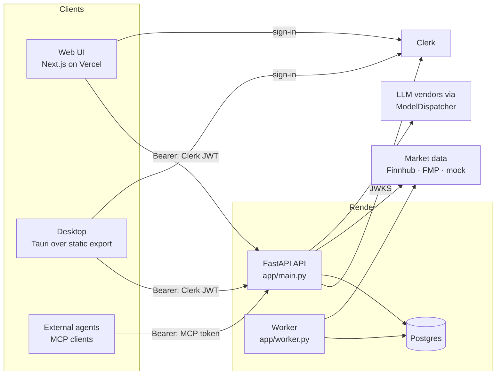

# MoatMine — High-Level Design

This document describes the system **as built**. Each
claim names the file it comes from. Where the code has no answer, this doc says so instead of
filling the gap. For which file holds what, see [`STRUCTURE.md`](STRUCTURE.md). For contracts
and the logic that isn't obvious, see [`LLD.md`](LLD.md).

## Requirements

### Functional
- **Safety score per stock.** A 0–100 score, with A–F grades by area and red flags, built from
  fundamentals, price risk, crisis behaviour, size, valuation and moat.
  - Calculation: `app/safety/score.py`.
  - Data gathering: `app/safety/service.py` `stock_safety`.
- **User risk rules.** A questionnaire sets the level, the rules can be edited, and the rules
  are stored per user (`app/safety/profile.py`, `RiskProfile` in `app/models.py`).
- **Every buy is checked against those rules.** The verdict is pass, warn or block
  (`app/safety/check.py` `check_buy`).
  - A warn needs a written reason and a cooling-off wait before the buy plan can execute
    (`app/routers/safety.py` `create_plan` / `execute_plan`).
- **Portfolio risk and stress tests.** Volatility, beta, VaR, drawdown, concentration and
  correlation, plus past crises and hypothetical 10/20/35% market falls replayed on today's
  holdings (`app/safety/risk.py`).
- **Real and paper books.** Paper (practice) accounts are a separate book. Totals, risk, stress,
  alerts and position sizing never mix the two (`app/portfolio.py`, `BookMode`).
  - Paper buys are priced at the live quote and paid from the paper account's cash
    (`pay_for_paper_buy`). Removing a paper position sells it at the quote. Paper positions can't
    be resized by editing, and an account can't move between books (`routers/portfolio.py`).
- **Targets and alerts.**
  - PAPI targets (Profit, Amount, Period, Intent) with MAMI min/max bounds (`app/targets.py`).
  - Watchlist price alerts.
  - A background worker turns breaches into deduplicated alerts (`app/worker.py`).
- **Research.** Fair value from several models (`app/valuation.py`), crisis history
  (`app/crises.py`), company data, earnings, analysts, dividends and news (`app/routers/stocks.py`).
- **AI agent.**
  - Chat with tool use over the user's own data, routed through ModelDispatcher
    (`app/ai/dispatcher.py`, `app/ai/tools.py`).
  - The same tools are served to external agents over MCP at `/mcp` (`app/mcp_server.py`).

### Non-functional (what the code enforces)
- **Runs without keys.** The mock market provider serves deterministic sample data
  (`app/market/mock.py`), and the UI labels it as sample data.
- **Honest data provenance.** Results built from fallback candles are labelled `mock-fallback`
  for each request (`app/market/sources.py`).
- **Fail closed on auth.** The API refuses to start with `AUTH_MODE=dev` on Postgres, or in clerk
  mode without the JWKS URL and issuer (`app/config.py` `_auth_is_safe`).
- **Secrets stay out of logs.** Finnhub's key is sent as a header, and `token=`/`apikey=` values
  are redacted in every log line (`app/log_config.py`).
- **Per-user AI limits:** requests per minute, tokens per minute and tokens per day
  (`ai_*` settings, enforced by ModelDispatcher's quota store).
- **Not set anywhere in the repo:** latency or availability targets (SLOs), and capacity numbers.

## Static view



| Component | Owns | Code |
|---|---|---|
| Web UI | All screens; one API client; Clerk sign-in gate | `web/src/app/*`, `web/src/lib/api.ts`, `web/src/components/AuthShell.tsx` |
| Desktop | Native window over the static export; no logic | `desktop/src-tauri/src/lib.rs`, `tauri.conf.json` |
| API: routers | HTTP surface, auth dependency, request validation | `app/routers/*.py`, `app/auth.py`, `app/schemas.py` |
| API: domain services | Gathering data for the maths; applying the user's rules | `app/safety/service.py`, `app/portfolio.py`, `app/research.py`, `app/targets.py` |
| Pure maths | Safety score, buy check, risk/stress, valuation, crises, moat | `app/safety/{score,check,risk,moat,profile}.py`, `app/valuation.py`, `app/crises.py`, `app/analytics.py` |
| Market data | Provider protocol, mock/Finnhub/FMP, routing and fallback, provenance | `app/market/*` |
| AI | Tool catalogue, ModelDispatcher wiring, encrypted per-user settings | `app/ai/*` |
| MCP server | Read-only tools for external agents, behind an MCP-token gate | `app/mcp_server.py` |
| Worker | Periodic alert evaluation | `app/worker.py` |
| Persistence | ORM models, sessions, Alembic migrations | `app/models.py`, `app/db.py`, `backend/migrations/` |

## Dynamic view

### Primary flow: checking a buy, then executing it through a plan

```mermaid
sequenceDiagram
  participant U as Web/Desktop
  participant R as routers/safety.py
  participant S as safety/service.py
  participant P as portfolio.py
  participant M as market provider
  participant C as safety/check.py
  U->>R: POST /plans {account_id, symbol, quantity, note}
  R->>M: quote(symbol)
  R->>S: check_for(user, symbol, amount, book of the account)
  S->>M: stock_safety(symbol): quote, candles, fundamentals, crises… (cached 10 min)
  S->>P: book_for(user, mode): snapshot of that book only
  S->>C: check_buy(rules, candidate, book)
  C-->>R: verdict pass | warn | block
  R-->>U: plan: ready | cooling_off (warn) | blocked; warn without a 20+ char reason → 422
  U->>R: POST /plans/{id}/execute (once ready)
  R->>S: check_for again (prices may have moved)
  R->>P: pay_for_paper_buy (paper accounts only; 409 if cash is short)
  R-->>U: holding created; the reason saved as a thesis note
```

### Other flows
- **Worker pass** (`app/worker.py` `run_once`), every `WORKER_INTERVAL_SECONDS`:
  1. For each user, check real-book concentration against the risk rules, evaluate PAPI
     targets, and check watchlist price levels.
  2. Write alerts deduplicated on `(user, dedupe_key, unread)`.
  3. Commit **per user**: one failing user doesn't drop anyone else's alerts.
- **Agent chat** (`app/routers/ai.py` → `app/ai/dispatcher.py` `chat`):
  1. Build a system prompt that includes the user's risk rules.
  2. ModelDispatcher picks a vendor from the user's keys and the server keys, and enforces quotas.
  3. Tool calls run through `app/ai/tools.py` `run_tool` against the same services the HTTP API
     uses.
- **MCP** (`app/mcp_server.py`):
  1. `_BearerGate` rejects requests without a valid hashed MCP token.
  2. Each tool resolves the user from the token and calls the same `run_tool`.

## Data storage
- **Primary store: Postgres on Render** (`render.yaml`, plan `basic-256mb`); SQLite locally and
  in tests.
  - All user data is in one schema (`app/models.py`): accounts, holdings, watchlist, stock
    notes, targets, alerts, AI settings (encrypted), MCP tokens (hashed), risk profiles and buy
    plans.
  - The schema is owned by Alembic (`backend/migrations/`). `render.yaml` runs
    `alembic upgrade head` as a pre-deploy step for both services. A Postgres advisory lock in
    `migrations/env.py` makes concurrent runs safe.
- **Cache: in-process only**, so each instance has its own:
  - `app/cache.py` `ttl_cache` holds safety reports (10 min) and sector lookups (1 h).
  - `app/research.py` keeps its own news-summary cache (`_TTL = 3600`).
  - ModelDispatcher's quota store is `InMemoryQuotaStore` (`app/ai/dispatcher.py`).
  - Running more than one API instance would split caches and quotas. Nothing coordinates them.
- **Blob storage:** none.
- **Backup/DR:** the repo doesn't document backups, point-in-time recovery or a restore
  procedure. Whatever the Render Postgres plan provides is all there is
  (BACKLOG #31 tracks a runbook).
- **Encryption at rest (application level):**
  - User AI keys are Fernet-encrypted with `FERNET_KEY` (`app/crypto.py`). Losing that key
    makes them unreadable, and no rotation is implemented.
  - MCP tokens are stored as SHA-256 hashes.

## Config management
- **Precedence:** process environment over a local `backend/.env` over defaults in
  `app/config.py` `Settings` (pydantic-settings). There is no secrets-manager integration.
  - Render injects secrets as environment variables (`sync: false` keys in `render.yaml`).
- **Fail fast.** Every entry point builds `Settings` before it serves traffic: `app/db.py`
  creates the engine at import time. An invalid or unsafe value raises `ConfigError`, which
  carries only the reasons, never the values.
  - Validated: `auth_mode` and `log_format` must be one of their `Literal` values, dev auth is
    refused on Postgres, and clerk mode must have its JWKS URL and issuer.
  - Not validated at startup: `FERNET_KEY`. Its absence surfaces on the first encrypt or
    decrypt as a `RuntimeError`, which `routers/ai.py` maps to HTTP 500.
- **Web config is baked in at build time:** `NEXT_PUBLIC_API_URL` and
  `NEXT_PUBLIC_CLERK_PUBLISHABLE_KEY`. Users can override the API URL in Settings (localStorage).

## Data validation / I/O
- **Edge validation:**
  - Pydantic models validate request bodies (`app/schemas.py`, plus inline models in
    `routers/safety.py` and `routers/ai.py`).
  - Query parameters carry FastAPI bounds, for example the valuation assumptions in
    `routers/stocks.py`.
  - Symbols are upper-cased at the edge.
  - Every record lookup checks ownership (`_own` helpers).
- **Responses are JSON.** Most domain results are plain dicts typed as `JSONDict`; few routes
  declare `response_model` (ARC-07 / BACKLOG #25). The web client mirrors the shapes by hand in
  `web/src/lib/api.ts`.
- **Provider responses are mapped defensively** (`.get` with defaults). A failed FMP call falls
  back to the primary provider. A failed quote marks the holding `stale` and prices it at cost.
- **AI tool arguments** come from the model and only get light checks: `run_tool` casts types
  but does not apply the HTTP bounds (SDR-10 / BACKLOG #21).

## Integration test strategy
- **API level:** `backend/tests/` drives the real FastAPI app through `TestClient` (`conftest.py`):
  - a throwaway SQLite database migrated with Alembic;
  - the mock market provider;
  - `AUTH_MODE=dev`, so the user is chosen by the bearer string.
- **Boundaries faked only at true I/O:**
  - LLM vendors: ModelDispatcher `MockProvider` doubles (`fake_ai`).
  - Finnhub and FMP: `httpx.MockTransport` (`test_finnhub.py`, `test_fmp.py`).
  - Clerk's JWKS: a locally generated RSA key (`test_auth.py`).
- **Schema drift:** `test_db.py` compares the models with the migrated database. The baseline
  migration was also run against a real Postgres 16, including two upgrades at once.
- **UI:** `docs/screenshots/shoot.js` loads every page against a running API and reports console
  errors, failed API calls and horizontal overflow. It is a manual step, not in CI.
- **CI** (`.github/workflows/ci.yml`):
  - ruff, mypy --strict and pytest;
  - `tsc` and both web builds;
  - `cargo check` for the desktop shell;
  - the repo-map drift check.
- **Not covered:** a live Clerk instance, a live Finnhub or FMP key, and end-to-end tests of the
  Tauri app.
