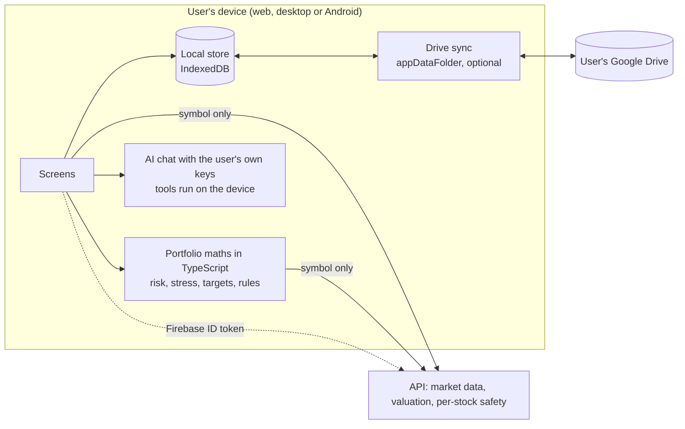

# Local-first MoatMine: design proposal

Status: **in progress.** Slice 0 (the store layer in `web/src/lib/store/`) is built. Slice 1 is started: the watchlist, stock notes, real-money accounts, positions, targets and the risk profile can live on the device behind an opt-in switch in Settings (`web/src/lib/data/`); plans, the portfolio risk and stress pages, paper accounts and alerts still use the server. Slice 2 is started: valuation and target evaluation are ported (`web/src/lib/calc/`) and checked against the Python on shared vectors; the safety check and profile rules are ported too; portfolio risk and stress maths are not yet. Everything after that is a proposal. It answers one question: what would it take for a
user's portfolio to live on their own devices, with the server holding no holdings?

## 1. Why

Today the operator can read everything a user enters: holdings, notes, targets, risk rules, plans.
Their AI keys are encrypted with the operator's `FERNET_KEY`, so the operator can decrypt them too
(`backend/app/models.py`, `backend/app/ai/settings_store.py`). If the app opens to other people,
that is a promise MoatMine cannot make ("your data stays with you") and a liability it would rather
not carry.

Goals:
- The server stores no per-user portfolio data and never receives holdings.
- The user keeps working with the same screens, on web, desktop and Android.
- Optional backup and sync through the user's own Google Drive (`appDataFolder`), with the sign-in
  the apps already use.

Non-goals: end-to-end-encrypted server sync (a later phase, only if server-side alerts on real
holdings are ever needed); changing market data, valuation or the safety score.

## 2. Where the repo stands

Per-user tables, all server-side (`backend/app/models.py`): `accounts`, `holdings`, `watchlist`,
`stock_notes`, `targets`, `alerts`, `risk_profiles`, `buy_plans`, `ai_settings`, `mcp_tokens`.

What reads them:

| Reader | Where | Needs the user's data to... |
|---|---|---|
| Portfolio, history, buy plans, accounts | `routers/portfolio.py`, `routers/safety.py` (`/plans`) | value holdings, execute plans |
| Portfolio risk, stress tests, safety check | `routers/safety.py` (`/safety/portfolio`, `/safety/stress`, `/safety/check`) | apply the user's rules to the whole book |
| Targets and their evaluation | `routers/targets.py`, `app/targets.py` | compare holdings with PAPI/MAMI bounds |
| AI chat tools | `app/ai/tools.py` (`get_portfolio`, `get_risk_profile`, `get_portfolio_risk`, `get_stress_test`, `get_targets_status`, `get_watchlist`, `get_notes`, `add_to_watchlist`, `save_note`) | answer from the user's own data |
| Alert pass | `app/worker.py`, `.github/workflows/alerts.yml`, `POST /internal/alerts/run` | check every user's targets, watchlist, loss limit and concentration each trading day |
| MCP server | `app/mcp_server.py` (`/mcp`) | give external agents the same tools |

What is already stateless and stays on the server: quotes, candles, profile, ratios, news,
earnings, analysts, dividends, valuation, crises, and a single stock's safety score
(`routers/stocks.py`, `GET /stocks/{symbol}/safety`). They take a symbol, not a user's data.

Already on the client: `modeldispatcher-browser-agent` is a web dependency, so AI calls can run in
the browser with the user's own keys.

## 3. Target architecture

The server keeps Firebase sign-in (rate limits, who may use the market-data quota) and the
symbol-only endpoints. It never sees a holding, a note or an AI key.

### 3.1 The store (a contract, then one implementation)

`web/src/lib/store/` defines a `PortfolioStore` interface: one typed collection per table above
(`accounts`, `holdings`, `watchlist`, `notes`, `targets`, `alerts`, `riskProfile`, `plans`,
`aiSettings`), each record with `id`, `updatedAt` and a `deleted` tombstone flag.
Screens depend on the interface, never on IndexedDB, so tests use an in-memory fake and a later
storage change touches one file. IndexedDB (not `localStorage`, which is too small and synchronous)
through a thin wrapper of our own; adopting a library such as `idb` is a decision to make then.

Browsers can evict site data, so the store must offer **export and import of one JSON file** from
day one, before any sync exists.

### 3.2 Portfolio maths on the device

Anything that needs the whole book cannot be a server endpoint without sending the book. Two ways:

| Option | What it means | Trade-off |
|---|---|---|
| **A. Port to TypeScript (recommended)** | Re-implement the pure functions (`app/safety/risk.py`, `check.py`, `app/portfolio.py`, `app/targets.py` evaluation) in `web/src/lib/calc/`, with the same hand-checkable tests | One-time cost, and two copies of the maths to keep equal; a shared table of test vectors in `docs/` or a JSON file both suites read keeps them honest |
| B. Stateless "compute" endpoint | Device posts positions (symbol, quantity, price) with no user id; server returns the numbers | Least work, but the operator still sees holdings in transit and in logs, which defeats the goal |

Per-stock inputs (candles, ratios, crises, the stock's own safety score) still come from the API by
symbol.

### 3.3 AI chat

The model runs through `modeldispatcher-browser-agent` with the user's keys held on the device.
The tools in `app/ai/tools.py` split in two: market tools call the API by symbol; the rest
(`get_portfolio`, `get_risk_profile`, `get_portfolio_risk`, `get_stress_test`, `get_targets_status`,
`get_watchlist`, `get_notes`, `add_to_watchlist`, `save_note`) become local functions over the store.
The rule that a write tool only runs for a symbol the user named (`user_named`) moves with them.

### 3.4 Drive sync (optional)

- One JSON file per collection in the app's hidden `appDataFolder`; Drive's `drive.appdata` scope
  only.
- Merge per record by `updatedAt`, last write wins, tombstones kept for 30 days. Fine for one
  person on a few devices; not for simultaneous editing, which this is not.
- The Google sign-in added for the apps gives Firebase an ID token only. Drive needs an OAuth access
  token with the extra scope, so the sign-in's consent request gains `drive.appdata` (a second,
  explicit "Sync with Google Drive" action, never silent) and the refresh token is kept on the
  device. This is a Google verification question too: `drive.appdata` is a non-sensitive scope, but
  check before launch.
- Data in `appDataFolder` is private to the app but not hidden from Google. Say so in the UI.

## 4. What breaks, and the options

| Feature | Breaks because | Options |
|---|---|---|
| **Alerts** (`app/worker.py`) | The server can no longer read targets, watchlist or risk rules | **(1)** Evaluate on app open and every N minutes while it is open: simplest, no push. **(2)** Plus local notifications on Android and desktop (needs `tauri-plugin-notification`). **(3)** A minimal server that stores only `symbol + threshold` with no user link and an anonymous push token: it can fire price alerts but not loss-limit or concentration alerts, which need holdings. Recommend (1) now, (2) next, skip (3) unless asked |
| **MCP server** (`/mcp`) | It serves tools over the user's data, which is no longer on the server | **(1)** Retire it. **(2)** Keep it as an opt-in "server mode" that stores data like today, off by default. **(3)** A local MCP endpoint in the desktop app only. Product decision |
| **Stored AI keys** | Move to the device | Straight win; the `ai_settings` table and `FERNET_KEY` custody (`docs/RUNBOOK.md`) go away |
| **Existing users' data** | Lives in Postgres | One-off "Move my data to this device": the app downloads everything through the current endpoints, verifies counts, then offers "delete it from the server" (a new `DELETE /me/data`) |
| **Web on a new device** | No data until sync or import | Drive sync restores it; without sync, import the exported file |

## 5. Plan

Each slice is shippable on its own, behind a switch that defaults to today's behaviour until the last
one. Estimates are rough: the earlier planning note gave 6-8 sessions for the whole phase.

| # | Slice | Done when | Sessions |
|---|---|---|---|
| 0 | `PortfolioStore` contract, IndexedDB and in-memory implementations, JSON export and import | Contract tests run against both implementations | 1 |
| 1 | Watchlist, notes, risk profile, targets, accounts, holdings and plans read and write the store; a "local mode" switch | Every screen works with the API's per-user routes unused | 2-3 |
| 2 | Port portfolio maths to TypeScript with shared test vectors | Same numbers as the Python on the vectors | 1-2 |
| 3 | AI chat tools over the store; keys on the device | Chat answers from local data in the browser | 1 |
| 4 | Alerts on app open (then local notifications) | A target breach raises an alert with no server call | 1 |
| 5 | Migration action and `DELETE /me/data`; drop the per-user tables and routes | A migrated test account is empty on the server | 1 |
| 6 | Drive sync | Two devices converge after edits on both | 1-2 |

## 6. Risks

- **Two copies of the maths** (slice 2) can drift. Shared vectors, run in both CI jobs.
- **Lost data**: a cleared browser or a lost phone with no sync loses the portfolio. Export, import
  and Drive sync are not extras.
- **Larger client bundle and a slower first load** from the ported maths; measure after slice 2.
- **Support**: with no server copy, the operator cannot recover a user's data. State it plainly.
- **Not verified**: this proposal has not been prototyped. In particular, run a spike for the Drive
  scope and refresh-token handling in the Tauri and Android apps before committing to slice 6.

## 7. Decisions needed before slice 0

1. Is "local mode" the new default for everyone, or an opt-in beside today's server mode?
2. MCP: retire, keep as opt-in server mode, or local-only (section 4)?
3. Alerts: is "on app open, then local notifications" enough?
4. Port the maths (option A) or accept the transient server call (option B)?
